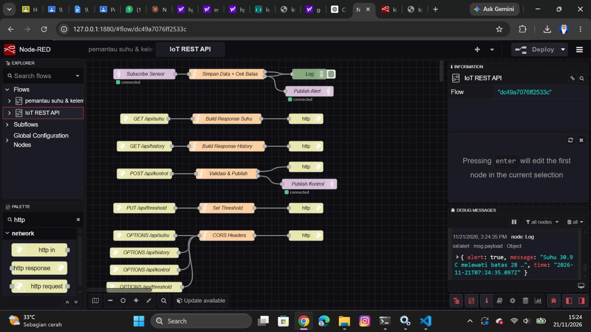
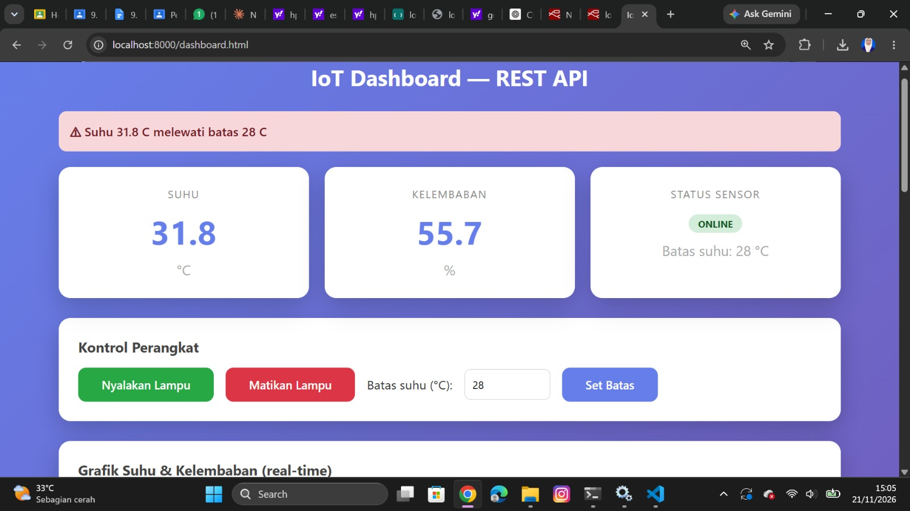
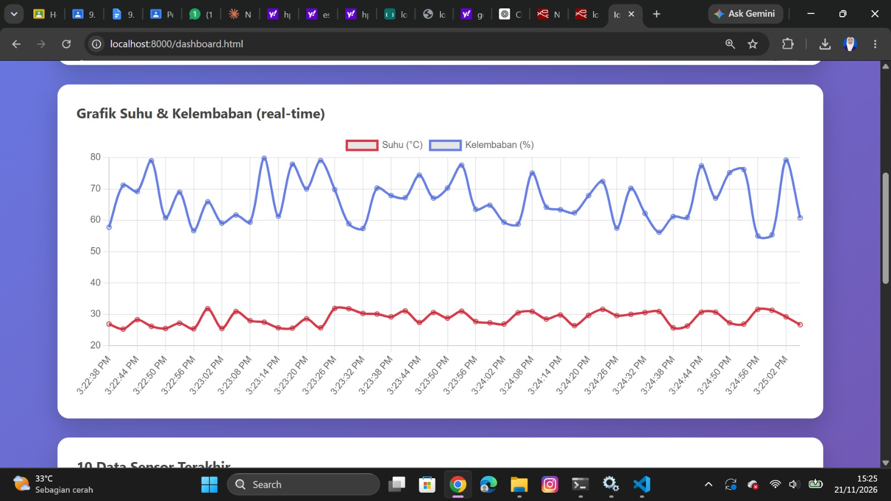
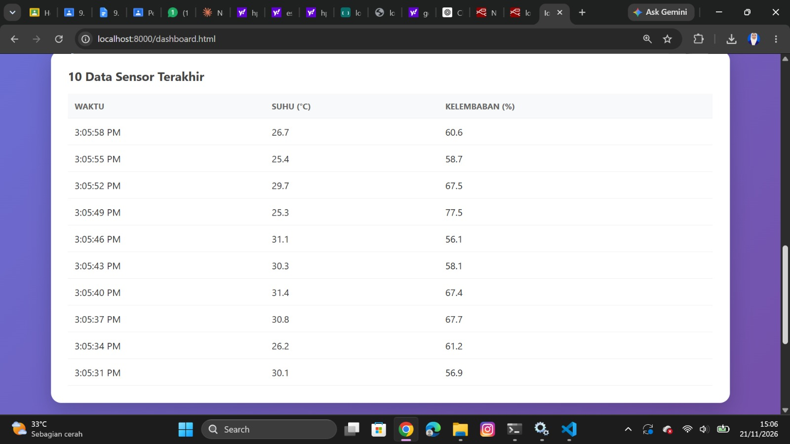
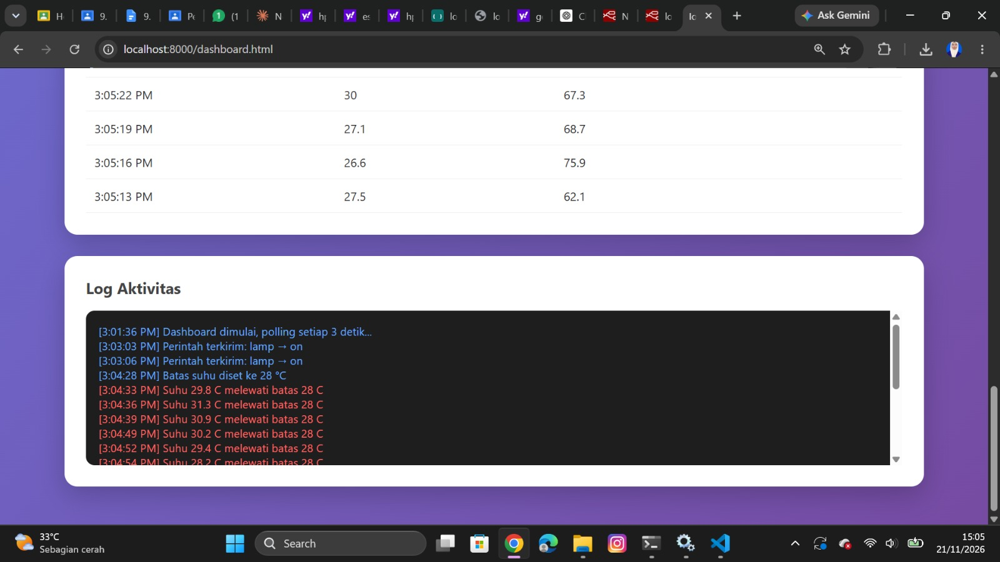
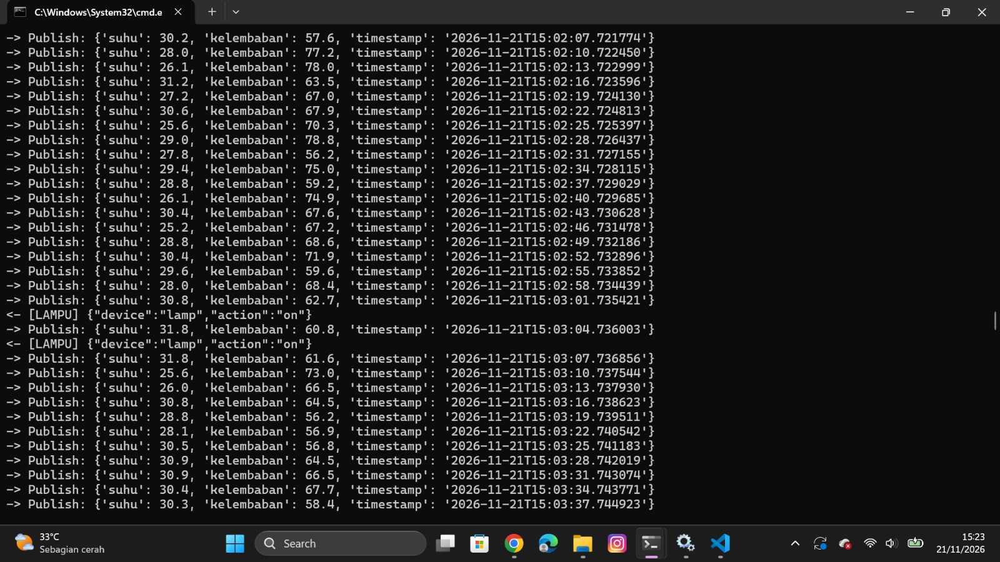
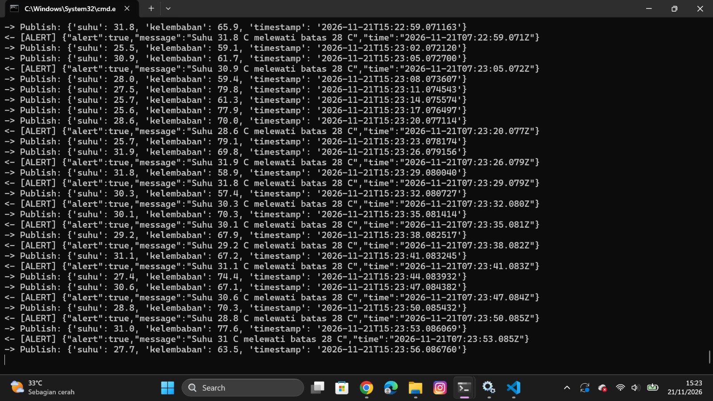
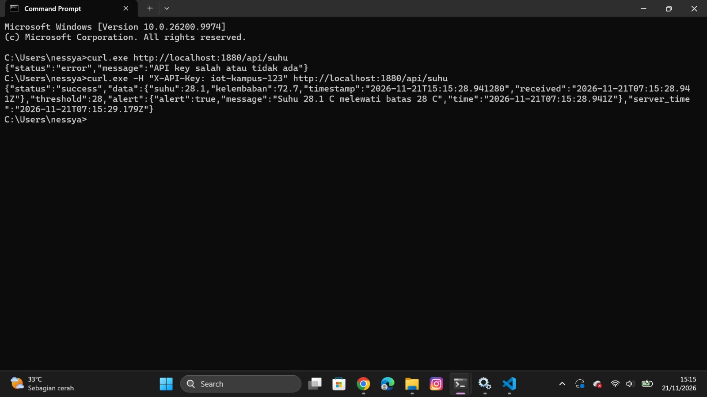

# Tugas Praktek 9 - REST API Node-RED untuk IoT

Sistem: Simulator ESP32 --MQTT--> Node-RED (REST API) <--fetch-- Dashboard Web.

## Isi
| File | Fungsi |
|---|---|
| `flow.json` | Flow Node-RED (import) |
| `build_flow.py` | Generator `flow.json` |
| `simulasi_esp32.py` | Simulator sensor + subscriber kontrol/alert |
| `dashboard.html` | Dashboard custom (HTML/CSS/JS) |

## Endpoint (semua butuh header `X-API-Key: iot-kampus-123`)
| Endpoint | Method | Fungsi |
|---|---|---|
| `/api/suhu` | GET | Data sensor terakhir + batas + alert |
| `/api/history` | GET | 50 data terakhir |
| `/api/kontrol` | POST | Kirim perintah, body `{"device":"lamp","action":"on"}` |
| `/api/threshold` | PUT | Set batas suhu, body `{"suhu_max":28}` |

## Cara menjalankan
1. `mosquitto -v` (broker, port 1883)
2. `node-red` lalu Import `flow.json` dan Deploy
3. `pip install -r requirements.txt` lalu `python simulasi_esp32.py`
4. Buka `dashboard.html` (double-click atau Live Server)

## Fitur bonus
- [x] PUT /api/threshold + notifikasi (banner di dashboard + publish MQTT `iot/alert`)
- [x] Grafik real-time Chart.js
- [x] Autentikasi API key (X-API-Key)
- [ ] WebSocket
- [ ] Database SQLite/InfluxDB

## Screenshot

### Flow Node-RED

### Dashboard (threshold dan banner alert)

### Grafik real-time Chart.js

### History 10 data terakhir

### Log aktivitas (kontrol dan set batas)

### Simulator ESP32 menerima perintah lampu

### Simulator ESP32 menerima alert

### Tes API key (curl)

